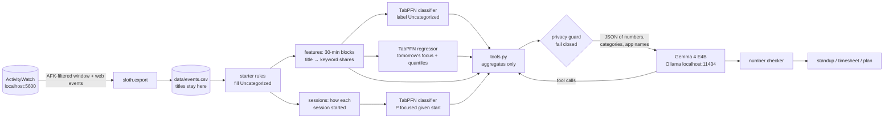

# Timesheet Sloth 🦥

A fully local agent that reads your [ActivityWatch](https://activitywatch.net) history and does the
work you hate: your standup, your weekly timesheet, labelling the time your category rules missed,
and telling you when to do hard work and when to rest without guilt.

- **TabPFN 3.5** (open weights, local, CPU) labels Uncategorized time, forecasts tomorrow's focus,
  and learns which ways of starting a session tend to end in focus.
- **Gemma 4 E4B** via Ollama (local, native tool calling) writes the prose, using only numbers the
  tools hand it.
- **Nothing leaves your machine.** The only network calls are to `localhost:5600` (ActivityWatch)
  and `localhost:11434` (Ollama), and that's enforced in code, not just promised.

Built for the DEV Hacktoberfest Open-Source AI Challenge, week 3: "Slow and Steady".

## Setup (5 commands)

You need [uv](https://docs.astral.sh/uv/), [Ollama](https://ollama.com) and ActivityWatch running,
plus a free TabPFN licence acceptance at [ux.priorlabs.ai](https://ux.priorlabs.ai). Put your API key
in `.env` as `TABPFN_TOKEN=...` (copy `.env.example`), or let `sloth setup` open the browser.

```sh
git clone https://github.com/Yarish652/MCP-AW.git timesheet-sloth && cd timesheet-sloth
uv sync
ollama pull gemma4:e4b
uv run sloth setup
uv run python -m sloth.export
```

`sloth setup` is the only step that downloads model weights (334 MB, once). `sloth.export` writes
`data/events.csv` and `data/blocks.csv` from your ActivityWatch server. On ActivityWatch v0.13,
category rules live in the web UI, so export them (Settings → Categorization → Export) and save
the file as `data/categories.json` first. Sloth's own starter rules cover common apps either way.

No ActivityWatch? `uv run sloth synth --out demo-data` makes six weeks of realistic fake data, and
every command takes `--data demo-data`.

## Use it

```sh
uv run sloth standup --date 2026-10-21    # Done / Focus / Next, from that day's numbers
uv run sloth timesheet --week             # per-day table + totals by category
uv run sloth plan-tomorrow                # the day after your last complete day of data
uv run sloth plan-tomorrow --no-llm       # just the raw TabPFN forecast, no Gemma
uv run sloth label --dry-run              # what TabPFN would call your Uncategorized time
uv run sloth label --tag                  # hand-tag the ~20 blocks it's least sure about
uv run sloth eval label|forecast|conditions|focus-definition
```

Add `--trace` to `standup`, `timesheet` or `plan-tomorrow` to see every tool call and every number
Gemma was given. Markdown copies land in `reports/` (gitignored, except `reports/eval.md`).

## How it works



1. **Labelling.** Your ActivityWatch rules (plus sloth's generic starter rules) label part of your
   time. TabPFN learns from those blocks and labels the rest, with a confidence for each block.
   Window titles never reach a model: they become "share of block time containing keyword *k*"
   columns named `tok_0..tok_39`.
2. **Focus.** Focus minutes are work-category time in blocks with at most 2 *shifts* from work to
   non-work (RescueTime's idea: editor ⇄ docs ⇄ AI chat is one task, not a distraction).
3. **Forecast.** TabPFN predicts tomorrow's focus per block from day-ahead features only, with
   10/50/90% quantiles.
4. **Focus conditions.** Predicting *when* an irregular person will focus doesn't work (see the
   numbers). So sloth also asks a question it *can* answer: given how a session starts (time,
   first app, what came before), how likely is it to become ≥ 25 focused minutes? It suggests at
   most one change, and only towards a way of starting you've actually used 8+ times.
5. **Agent.** Gemma 4 calls six tools (`day_summary`, `week_summary`, `label_uncategorized`,
   `forecast_tomorrow`, `top_distractions`, `focus_conditions`) and writes the text. A checker
   flags any number in the text that isn't in a tool result.

## Privacy guarantees

| Guarantee | How it's enforced | Tested by |
|---|---|---|
| No network except localhost | `sloth.netguard` patches `socket.connect`/`getaddrinfo` to refuse non-loopback addresses for every command except `sloth setup` | `test_netguard_blocks_non_local_and_allows_loopback` |
| No titles/URLs to the LLM | Tools return aggregates; the single path into the prompt (`agent._tool_message`) runs `privacy.Guard.check`, which raises if any title or URL from your data appears, without echoing it | `test_no_tool_ever_returns_the_canary`, `test_guard_blocks_titles_and_urls_without_echoing_them` |
| No raw text in models | TabPFN sees numbers and integer-encoded categories; titles become keyword shares | the `sloth eval label` leakage check |
| Your data stays out of git | `data/`, `*.csv`, `.env`, `reports/*.md` (except `eval.md`) are gitignored | — |
| TabPFN is offline after setup | The licence check and Hugging Face download happen only when weights aren't cached (read in TabPFN's source); `HF_HUB_OFFLINE=1` is set at runtime | the offline test below |

What it does share with Gemma (locally): category names, app executable names (e.g. `Code.exe`),
hours, counts, times of day. An app name can itself be revealing; there's no allow-list for those yet.

The coding assistant that helped build this (a closed model) never saw the real data either: it
worked against `sloth synth` output and only ran aggregate-printing scripts on the real export.

## Results (real data: one person, ~14 weeks, 151 active hours)

Everything below is in [`reports/eval.md`](reports/eval.md), regenerated by `sloth eval`. Where
TabPFN loses, the table says so.

**Labelling Uncategorized time** (time-based holdout, last 14 days; macro-F1 in brackets)

| | TabPFN | top_app lookup | majority class |
|---|---|---|---|
| Real, your rules + starter rules (281 train / 99 test) | **0.81** (0.73) | 0.33 (0.17) | 0.27 (0.07) |
| Real, your ActivityWatch rules only (48 / 55) | **0.73** (0.34) | 0.67 (0.20) | 0.67 (0.20) |
| Synthetic, *truly* uncategorized blocks vs hidden truth | **0.87** (0.75) | 0.25 (0.27) | 0.19 (0.05) |

Holdout blocks were labelled by rules, so part of TabPFN's score is relearning those rules
(synthetic holdout: 99.5% → 87% on genuinely uncategorized time). The honest real-data metric
is `sloth eval label --handlabeled labels.csv` after `sloth label --tag`; **no hand labels have been
collected yet**.

**Forecasting tomorrow's focus** (14-day rolling origin, focus = shifts ≤ 2, mean 0.93 h/day)

| | block MAE (min) | daily-total MAE (h) |
|---|---|---|
| TabPFN | 1.54 | 0.66 |
| same as last week | 1.86 | 0.89 |
| rolling 4-week mean | 1.67 | **0.65** |
| always zero | **1.16** | 0.93 |

**TabPFN does not win here.** Per block, "always zero" is best: most half-hours have no focus,
and MAE rewards the median. On daily totals it ties the 4-week mean. Only 11–13% of this person's
focus blocks recur in the same slot a day or a week later, and 41% happen between 00:00 and 06:00.
There's no schedule to forecast. Its 80% intervals are also too wide (they cover 88.8% of blocks).

**Which session starts lead to focus** (holdout, last 14 days, 295 sessions, 19% focused)

| | ROC-AUC ↑ | Brier ↓ | log-loss ↓ |
|---|---|---|---|
| TabPFN | **0.747** | **0.119** | **0.387** |
| rate by start hour | 0.516 | 0.127 | 0.425 |
| base rate | 0.500 | 0.126 | 0.421 |

This is where TabPFN clearly helps (synthetic: 0.80 vs 0.70), but the test set holds only ~8
focused sessions, so treat the AUC as noisy. The suggestion it produced ("in the evening, open
your work first instead of an uncategorized app: 7% → 44%, from 39 sessions") is a correlation,
and partly circular: starting with work is already working.

**Speed** (Ryzen 5 7520U, 16 GB, CPU only). `plan-tomorrow` end to end: **~5 min** (TabPFN
forecast 116 s on 4,704 training blocks, focus conditions 4 s, Gemma 155 s for 2 calls).
Labeller eval ~22 s; forecast backtest ~15 min (14 refits). TabPFN's `fit` is ~0.3 s and
`predict` does the work (it's an in-context learner). RAM is the bottleneck: with ~1 GB free, the
same TabPFN call took 30–40 s instead of 4 s, Gemma dropped to ~1 token/s, and a `standup` took
13 min 43 s. Sloth runs TabPFN first and only then loads Gemma, so the two never share memory.
It's a sloth.

## Offline

Turn off Wi-Fi and `sloth standup` / `sloth plan-tomorrow` keep working. That needs, done once while
online: `uv sync`, `ollama pull gemma4:e4b` and `sloth setup` (weights cached in your TabPFN cache
dir). Use `uv run --offline sloth ...` so uv never tries to re-resolve packages. Every command
except `sloth setup` runs behind the localhost-only network guard anyway, so if anything tried to
reach the internet it would fail loudly rather than quietly succeed.

## Limitations

- Patterns from one person's history aren't causes. "Tends to", with counts, is as strong as the
  claims get.
- ActivityWatch sees one computer. Phone, paper and lectures are invisible.
- Days run midnight to midnight; ActivityWatch's web UI defaults to 04:00, so night owls will see
  different daily totals there.
- Focus depends on labels: ~35% of real time is still Uncategorized, and the starter rules count
  AI-chat sites as Work.
- TabPFN on CPU handles ~5,000 training rows; older history is dropped beyond that.

## Development

```sh
uv run pytest            # 69 tests on synthetic data (one runs the real TabPFN; ~4 min)
uv run ruff check && uv run ruff format
```

Decisions, surprises and everything that broke: [`NOTES.md`](NOTES.md). MIT licensed.
